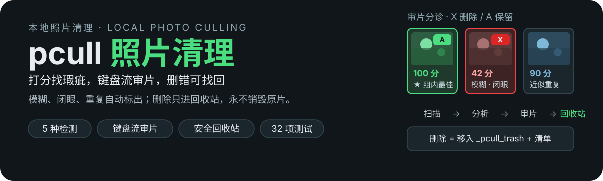
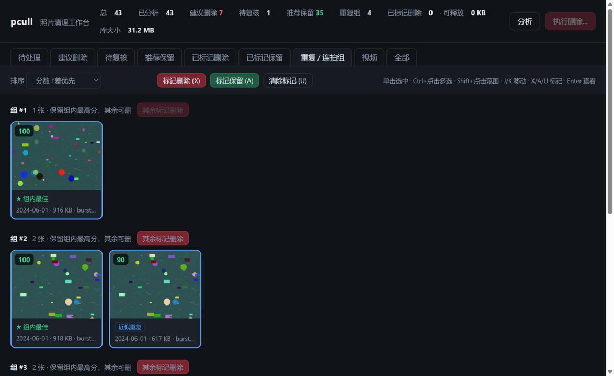
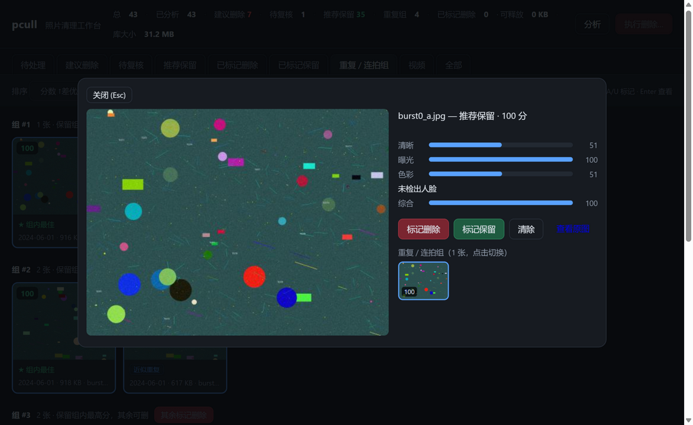

<p align="right"><a href="README.md">中文</a></p>

<p align="center">
  
</p>

<p align="center">
  <a href="https://github.com/holynova/photo-culler">GitHub Repository</a>
</p>

pcull is a local-first photo culling tool. Point it at a folder copied from your phone; it scores every photo and video (blur, exposure, closed eyes, near-duplicates, sampled video frames), then you triage in a keyboard-driven local web UI. Marked files are moved to a trash folder with a manifest — nothing is ever destroyed.

## Screenshots

<p align="center">
  
</p>

<p align="center">
  
</p>

> The screenshots use synthetic images from the demo library (generated by `scripts/make_demo_lib.py`), not real photos.

## Workflow

```
scan → analyze → serve → apply
index   score / flaws / dedup   review in browser   move to trash
```

1. `pcull scan <library>`: index files, EXIF, and dimensions into SQLite.
2. `pcull analyze <library>`: run the analysis pipeline (thumbnails, quality, closed eyes, dedup) across 4 processes.
3. `pcull serve`: open the local review UI (http://127.0.0.1:8787) for keyboard triage.
4. `pcull apply <library>`: move marked files to `<library>/../_pcull_trash/<timestamp>/` and write a move manifest; `--dry-run` previews the manifest without touching files.

## Quick Start

macOS / Linux:

```bash
git clone https://github.com/holynova/photo-culler && cd photo-culler
python3.12 -m venv .venv
.venv/bin/python -m pip install -e . -r requirements.txt
.venv/bin/pcull serve     # http://127.0.0.1:8787 — pick a photo folder on the start page
```

Windows (PowerShell):

```bash
git clone https://github.com/holynova/photo-culler && cd photo-culler
py -3.12 -m venv .venv
.venv\Scripts\python.exe -m pip install -e . -r requirements.txt
.venv\Scripts\pcull.exe serve     # http://127.0.0.1:8787 — pick a photo folder on the start page
```

`requirements.txt` includes mediapipe for closed-eye detection; installing just `-e .` also works, but closed-eye detection is skipped (the stats bar shows 「闭眼检测未启用」 "Closed-eye detection not enabled"). The first time closed-eye detection runs, it downloads a ~15 MB MediaPipe model to `~/.pcull_models/` — internet required.

## Detectors

| Check | Method |
| --- | --- |
| Blur | Normalized Laplacian variance, three penalty tiers |
| Exposure | Histogram clipping, distinguishing too dark from overexposed |
| Closed eyes | MediaPipe face blendshapes (optional dependency) |
| Duplicates / bursts | Perceptual-hash clustering, best of group kept |
| Video | ffprobe metadata + 6 uniformly sampled frames scored |

A composite score of 0–100 comes with a reason list (「模糊」 "blurry", 「闭眼」 "closed eyes", 「过暗」 "too dark", 「重复组非最佳」 "not the best in a duplicate group", …) and a three-tier recommendation: keep / review / delete. The machine only suggests; a human must mark before anything moves.

## Keyboard

| Key | Action |
| --- | --- |
| `J` / `K` (or ↑ ↓) | Move focus up/down |
| `X` | Mark for deletion |
| `A` | Mark to keep |
| `U` / Backspace | Clear mark |
| `Enter` | Open the detail drawer |
| `Esc` | Close the drawer |

Mouse works too: click to select, Ctrl+click for multi-select, Shift+click for a range.

## Tech

- Python 3.12 · FastAPI + uvicorn · OpenCV · MediaPipe (optional) · imagehash · SQLite.
- The review UI is vanilla JS with no build step (`static/`), served directly by FastAPI.
- Tests: 32 pytest tests driven by synthetic-image fixtures (just run `pytest`).
- Optional neural aesthetics scoring (torch + pyiqa) has a reserved interface and is not installed by default: `pip install .[neural]`.

```
src/pcull/
├── cli.py         pcull scan | analyze | serve | apply | status
├── scanner.py     Directory scanning + EXIF / dimensions / video metadata
├── analyzers/     thumbs / quality (blur / exposure / color) / faces (closed eyes) / dedup (phash) / video (frame sampling)
├── scoring.py     Composite 0–100 score + keep / review / delete recommendations
├── apply.py       Safe move to trash directory + move manifest
├── server.py      FastAPI: REST API + static review UI
└── db.py          SQLite index (photos / metrics / groups / decisions)
static/            Review UI (vanilla JS, no build)
scripts/make_demo_lib.py   Generate a demo photo library (synthetic images)
```

## License

MIT, see `LICENSE`.
