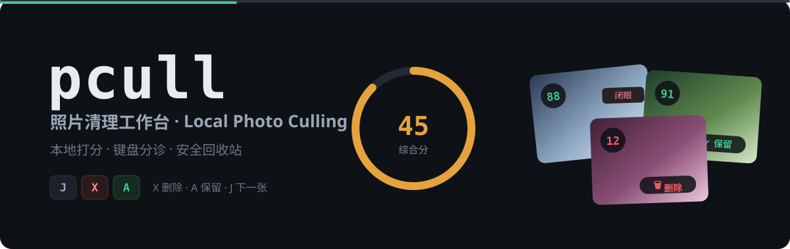
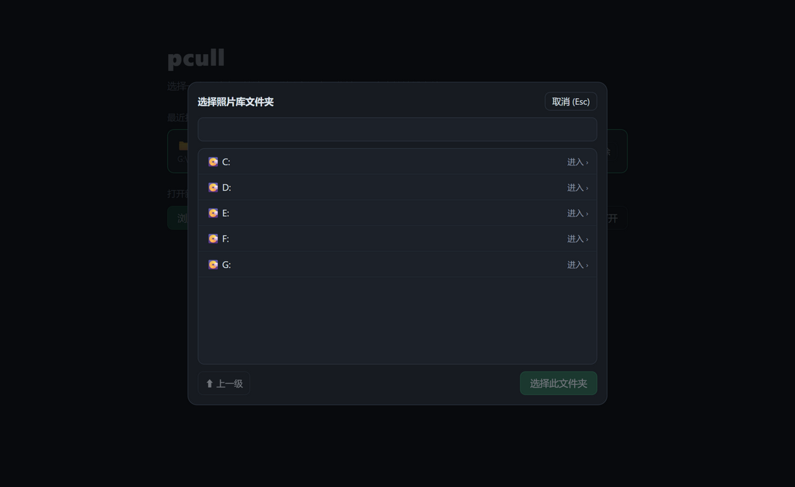
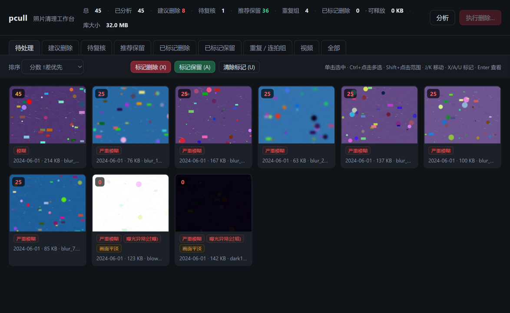
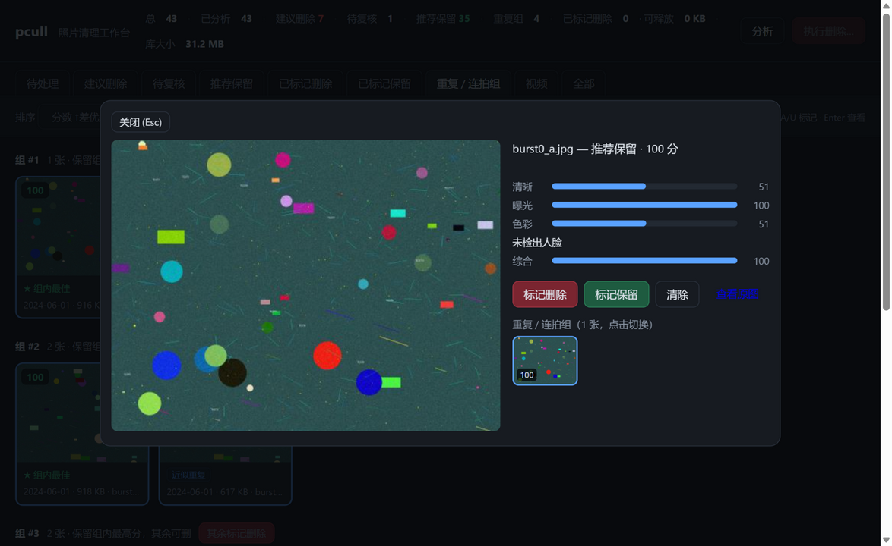
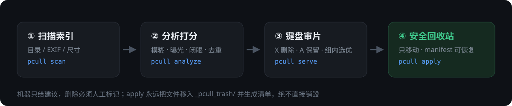

# pcull · 照片清理工作台



**中文**：把手机照片拷进电脑，一条管线自动打分并标记瑕疵（模糊、过曝、闭眼、近似重复、视频抽帧），再在本地网页里键盘分诊：`X` 删除、`A` 保留、连拍组一键选优。标记结果只移入回收站目录并生成清单，绝不直接销毁文件。

**English**: A local-first photo culling tool. Point it at a folder copied from your phone; pcull scores every photo and video (blur, exposure, closed eyes, near-duplicates, sampled video frames), then you triage in a keyboard-driven web UI. Marked files are moved to a trash folder with a manifest — nothing is ever destroyed.





## 在线体验 / Live Demo

- [Cloudflare Demo（三个可交互 UI 原型）](https://photo-culler.xiaosang.cc/)
- [GitHub Repo](https://github.com/holynova/photo-culler)


## 工作流 / Workflow



## 快速开始 / Quick start

```bash
git clone https://github.com/holynova/photo-culler && cd photo-culler
py -3.12 -m venv .venv
.venv/Scripts/python.exe -m pip install -e .
.venv/Scripts/pcull.exe serve     # http://127.0.0.1:8787，启动页里选择照片文件夹
```

## 检测器 / Detectors

| 检测 | 方法 |
| --- | --- |
| 模糊 | Laplacian 方差归一化，三档惩罚 |
| 曝光 | 直方图裁剪，区分过暗/过曝 |
| 闭眼 | MediaPipe 人脸 blendshapes |
| 重复/连拍 | phash 感知哈希聚类，组内保最优 |
| 视频 | ffprobe 元信息 + 均匀抽 6 帧评分 |

Python 3.12 · FastAPI · OpenCV · MediaPipe · 32 项 pytest · MIT License

## 发布 / Deploy

```bash
npx wrangler deploy --config wrangler.jsonc
```

Cloudflare Workers · Custom Domain: `photo-culler.xiaosang.cc` · 源码与部署配置同一主分支，本地手动发布
