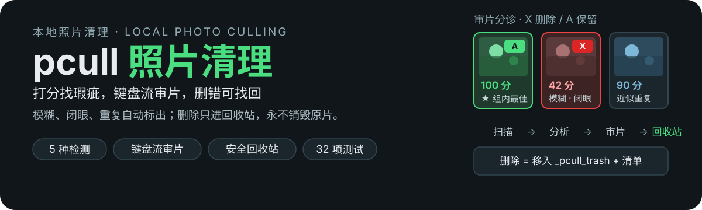
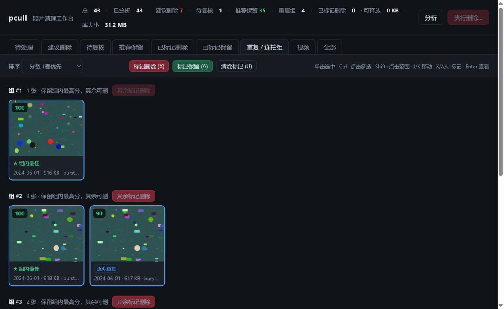
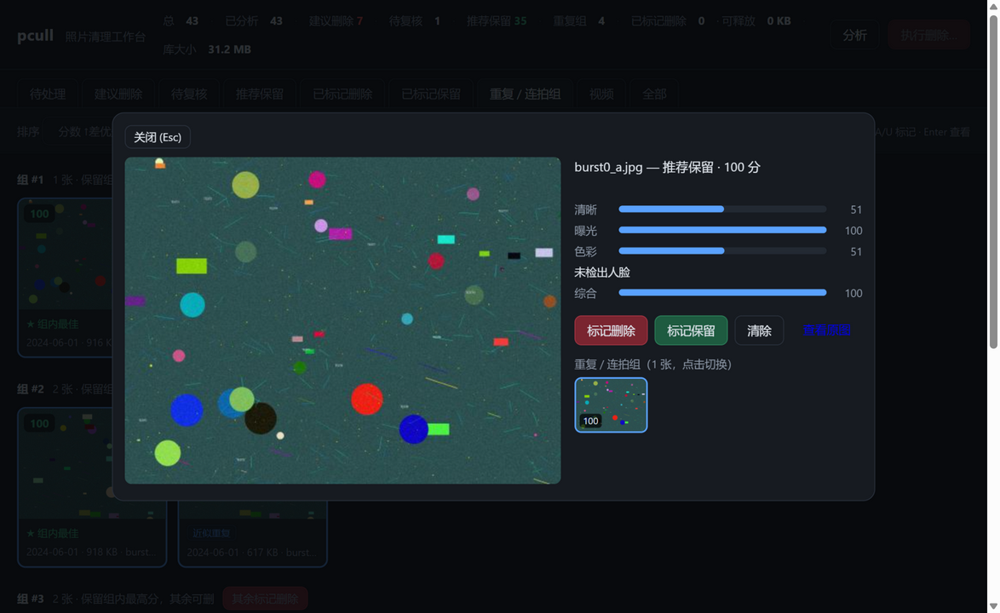

<p align="center">
  
</p>

<p align="center">
  <a href="https://github.com/holynova/photo-culler">GitHub 仓库</a>
</p>

pcull 是本地照片清理工作台：把手机照片拷进电脑，一条管线自动打分并标记瑕疵（模糊、过曝、闭眼、近似重复、视频抽帧），再在本地网页里键盘分诊——`X` 删除、`A` 保留、连拍组一键选优。标记结果只移入回收站目录并生成清单，绝不直接销毁文件。

pcull is a local-first photo culling tool. Point it at a folder copied from your phone; it scores every photo and video (blur, exposure, closed eyes, near-duplicates, sampled video frames), then you triage in a keyboard-driven local web UI. Marked files are moved to a trash folder with a manifest — nothing is ever destroyed.

## 截图 / Screenshots

<p align="center">
  
</p>

<p align="center">
  
</p>

> 截图用的是演示库里的合成图片（`scripts/make_demo_lib.py` 生成），不是真实照片。

## 工作流 / Workflow

```
scan → analyze → serve → apply
索引    打分/瑕疵/去重   网页审片   移入回收站
```

1. `pcull scan <照片库>`：索引文件、EXIF、尺寸，写入 SQLite。
2. `pcull analyze <照片库>`：跑分析管线（缩略图、质量、闭眼、去重），4 进程并行。
3. `pcull serve`：打开本地审片界面（http://127.0.0.1:8787），键盘分诊。
4. `pcull apply <照片库>`：把标记删除的文件移入 `<照片库>/../_pcull_trash/<时间戳>/`，并生成移动清单；支持 `--dry-run` 先看清单不动文件。

## 快速开始 / Quick Start

macOS / Linux：

```bash
git clone https://github.com/holynova/photo-culler && cd photo-culler
python3.12 -m venv .venv
.venv/bin/python -m pip install -e . -r requirements.txt
.venv/bin/pcull serve     # http://127.0.0.1:8787，启动页里选择照片文件夹
```

Windows（PowerShell）：

```bash
git clone https://github.com/holynova/photo-culler && cd photo-culler
py -3.12 -m venv .venv
.venv\Scripts\python.exe -m pip install -e . -r requirements.txt
.venv\Scripts\pcull.exe serve     # http://127.0.0.1:8787，启动页里选择照片文件夹
```

`requirements.txt` 里包含闭眼检测用的 mediapipe；只装 `-e .` 也能运行，但闭眼检测会跳过（界面统计栏会提示「闭眼检测未启用」）。首次启用闭眼检测时会自动下载约 15 MB 的 MediaPipe 模型到 `~/.pcull_models/`，需要联网。

## 检测器 / Detectors

| 检测 | 方法 |
| --- | --- |
| 模糊 | Laplacian 方差归一化，三档惩罚 |
| 曝光 | 直方图裁剪，区分过暗/过曝 |
| 闭眼 | MediaPipe 人脸 blendshapes（可选依赖） |
| 重复/连拍 | phash 感知哈希聚类，组内保最优 |
| 视频 | ffprobe 元信息 + 均匀抽 6 帧评分 |

综合分 0–100，附理由列表（「模糊」「闭眼」「过暗」「重复组非最佳」……），建议分三档：保留 / 待复核 / 建议删除。机器只给建议，删除必须经人工标记。

## 键盘流 / Keyboard

| 按键 | 动作 |
| --- | --- |
| `J` / `K`（或 ↑ ↓） | 上下移动焦点 |
| `X` | 标记删除 |
| `A` | 标记保留 |
| `U` / Backspace | 清除标记 |
| `Enter` | 打开详情抽屉 |
| `Esc` | 关闭抽屉 |

也支持鼠标：单击选中、Ctrl+点击多选、Shift+点击选范围。

## 技术 / Tech

- Python 3.12 · FastAPI + uvicorn · OpenCV · MediaPipe（可选）· imagehash · SQLite。
- 审片 UI 是无构建步骤的原生 JS（`static/`），直接由 FastAPI 提供。
- 测试：32 项 pytest，合成图片 fixture 驱动（`pytest` 直接跑）。
- 可选的神经美学评分（torch + pyiqa）预留了接口，默认不装：`pip install .[neural]`。

```
src/pcull/
├── cli.py         pcull scan | analyze | serve | apply | status
├── scanner.py     目录扫描 + EXIF/尺寸/视频元信息
├── analyzers/     thumbs / quality（模糊/曝光/色彩）/ faces（闭眼）/ dedup（phash）/ video（抽帧）
├── scoring.py     综合分 0–100 + 保留/复核/删除建议
├── apply.py       安全移动到回收站目录 + 移动清单
├── server.py      FastAPI：REST API + 静态审片 UI
└── db.py          SQLite 索引（photos / metrics / groups / decisions）
static/            审片 UI（原生 JS，无构建）
scripts/make_demo_lib.py   生成演示照片库（合成图片）
```

## English

**pcull** is a local photo culling workbench: copy phone photos to your PC, let the pipeline score each one and flag flaws — blur, bad exposure, closed eyes, near-duplicates, and sampled video frames — then triage in a keyboard-driven local web UI (`X` delete, `A` keep, one-click best-of-burst). Deletions only ever move files into a timestamped trash folder with a manifest.

- **Detectors**: blur (Laplacian variance), exposure (histogram clipping), closed eyes (MediaPipe face blendshapes, optional), duplicates (perceptual-hash clustering, best-of-group kept), video (ffprobe metadata + 6 uniformly sampled frames).
- **Scoring**: composite 0–100 score with reasons, recommending keep / review / delete. The machine only suggests; a human must mark before anything moves.
- **Safety**: `pcull apply` moves marked files to `<library>/../_pcull_trash/<timestamp>/` and writes a manifest; `--dry-run` previews the move. Originals are never unlinked.
- **Run it**: Python 3.12, `pip install -e . -r requirements.txt`, then `pcull serve` (http://127.0.0.1:8787).
- **Tech**: FastAPI + uvicorn, OpenCV, SQLite, vanilla-JS UI with no build step. 32 pytest tests.

## 许可 / License

MIT，见 `LICENSE`。
